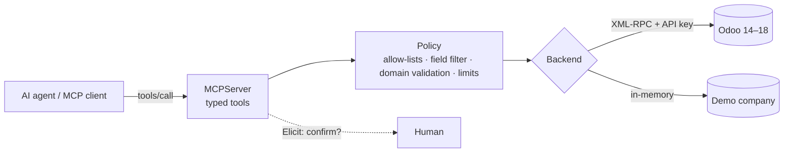

# odoo-mcp

**An MCP server that lets AI agents (Claude, ChatGPT, Cursor, any MCP client) work with an Odoo ERP — safely.**
Ask *"who should we chase for payment this week?"* or *"draft a quote for Hotel Arunika: 20 kg House Blend"* and the agent
calls typed, guarded tools instead of getting raw database access.

[](https://github.com/affifariza04/odoo-mcp/actions/workflows/ci.yml)
 -111) 

Built on the **MCP Python SDK 2.x** (protocol `2026-07-28`): structured tool output, tool annotations, and
human-in-the-loop confirmation through the new `Resolve` / `Elicit` flow.

---

## Why

Most "chat with your ERP" demos hand the model a database connection and hope. In a real company that is a non-starter:
finance data, customer data and the ability to create documents all need guardrails. This server is opinionated about that:

| Concern | What odoo-mcp does |
|---|---|
| **Least privilege** | Read-only by default. Writes need `ODOO_MCP_MODE=readwrite` *and* the model must be in an allow-list (only `sale.order`). |
| **Human in the loop** | `create_quotation` shows the human a summary (customer, lines, total) and only writes on an explicit *Confirm*. Decline/cancel writes nothing. Quotes are created as **draft**, never confirmed or sent. |
| **No data exfiltration** | Model allow-list; credential/token/binary fields (`password`, `api_key`, `totp_secret`, `image_1920`…) can't be read *or* filtered on. Row limits are clamped. |
| **Well-formed requests only** | Odoo domains are validated (shape + operator allow-list) before they reach Odoo. |
| **Errors the model can fix** | Anticipated failures (policy, bad dates, unknown ids) come back as tool errors with a clear message; unexpected exceptions are hidden from the model and logged. |
| **API keys, not passwords** | Authenticates with an Odoo API key over the external API. |

## Tools

| Tool | Kind | What it does |
|---|---|---|
| `find_customers(query)` | read | Customers by name, email or city |
| `check_stock(query?, only_low?)` | read | On-hand qty per product, flagged `ok` / `low` / `out` — a reorder list |
| `sales_report(date_from, date_to, group_by)` | read | Confirmed sales grouped by `month`, `customer` or `product` (via `read_group`) |
| `overdue_invoices(as_of?)` | read | Unpaid posted invoices past due, most overdue first |
| `search_records(model, domain, fields, limit, order)` | read | Guarded generic `search_read` for anything else |
| `create_quotation(customer_id, lines)` | **write** | Draft quotation, after human confirmation |

Plus a resource (`odoo://models`: what is exposed and whether writes are on) and a prompt
(`month_end_review`: sales vs last month, who to chase, what to reorder).

Every tool returns **typed, structured output** (Pydantic models → JSON Schema), so clients can render tables
and agents don't have to parse prose.

## Try it in 30 seconds (no Odoo needed)

Without `ODOO_URL` the server runs against a built-in demo company (a fictional coffee roaster with customers,
products, orders and invoices):

```bash
git clone https://github.com/affifariza04/odoo-mcp && cd odoo-mcp
uv sync
uv run python examples/demo.py      # launches the server over stdio and runs an agent-style session
```

```text
> overdue_invoices({"as_of": "2026-11-22"})
  INV/2026/0004  PT Sinar Retail     due 2026-10-02   51 days   12,540,000
  INV/2026/0008  Lantai Dua Coffee   due 2026-11-16    6 days    5,050,000

[human is asked]
Create a draft quotation for Hotel Arunika (total 7,940,000)?
  20 x House Blend 1kg
  12 x Gayo Arabica 250g
[human clicks: Confirm]

> create_quotation(...)  ->  {"name": "S00013", "customer": "Hotel Arunika", "total": 7940000.0, "state": "draft"}
```

## Use it with Claude Desktop / Cursor

```jsonc
{
  "mcpServers": {
    "odoo": {
      "command": "uvx",
      "args": ["--from", "git+https://github.com/affifariza04/odoo-mcp", "odoo-mcp"],
      "env": {
        "ODOO_URL": "https://your-company.odoo.com",
        "ODOO_DB": "your-db",
        "ODOO_USER": "you@company.com",
        "ODOO_API_KEY": "…",            // Odoo → Preferences → Account Security → New API Key
        "ODOO_MCP_MODE": "readonly"      // or "readwrite" to enable create_quotation
      }
    }
  }
}
```

Remote/HTTP clients: `odoo-mcp --http` serves Streamable HTTP.

## Architecture



```
src/odoo_mcp/
  server.py    tools, resource, prompt, confirmation resolver, entry point
  policy.py    guardrails (pure, unit-tested)
  backend.py   XmlRpcBackend (real Odoo) + DemoBackend (in-memory, with an Odoo domain evaluator)
tests/         policy + domain unit tests, end-to-end tests through a real MCP client
examples/      stdio demo session
```

## Tests

```bash
uv run pytest -q       # 20 tests
uv run ruff check .
```

The end-to-end tests connect a real `mcp.Client` to the server and cover: tool listing and annotations,
each business tool's numbers on the demo company, policy errors surfacing to the model, read-only mode
refusing writes, and the confirmation flow (accept → created; reject/decline → nothing written).
CI runs the suite on Python 3.12 and 3.13, plus the stdio demo.

## Roadmap

- Purchase suggestions from stock velocity (`suggest_reorder`)
- Per-user auth on the HTTP transport (OAuth), mapping each user to their own Odoo API key
- Audit log of every write the agent proposes and what the human decided

---

Built by [Affif Ariza Adiwijaya](https://affifariza04.github.io/portfolio/): 1.5 years building on Odoo, now building AI tooling around it. MIT licensed.
